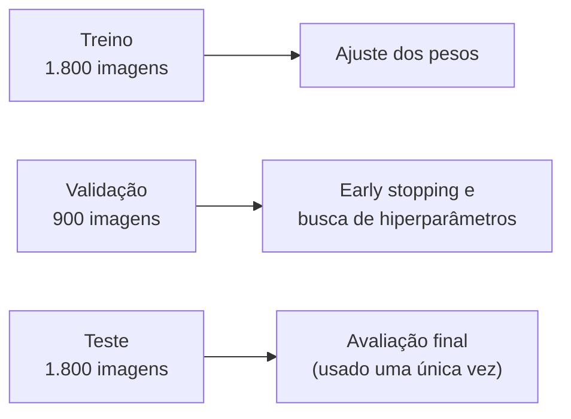

# Metodologia

Este documento descreve as decisões tomadas em cada etapa do projeto e os critérios usados para avaliá-las. Todos os valores citados vêm dos notebooks em [`notebooks/`](../notebooks), que mantêm as saídas gravadas.

---

## 1. Objetivo

Adaptar um detector de placas pré-treinado em placas de diversos países (`number-plate-yolo26s`) ao padrão brasileiro e medir, de forma reproduzível, o ganho obtido em relação ao modelo base.

---

## 2. Dados

**Dataset:** UFPR-ALPR, com 4.500 imagens em 1.920×1.080 px de 150 veículos (30 quadros por veículo), entre carros e motos.

**Divisão:** foi usada a divisão oficial do dataset, em que cada veículo aparece em uma única partição. Assim, nenhum veículo do conjunto de teste é visto durante o treino ou a seleção de hiperparâmetros.

**Anotações:** o UFPR-ALPR registra os quatro cantos de cada placa. Eles foram convertidos para o formato YOLO como o menor retângulo que contém os quatro pontos, com coordenadas normalizadas e uma única classe (`license_plate`).

---

## 3. Fine-tuning v1: decisões e justificativas

| Decisão | Valor | Justificativa |
|---|---|---|
| Resolução de entrada (`imgsz`) | 1280 (modelo base: 640) | Em 640 px, a placa de uma moto ocupa cerca de uma célula da grade de detecção; em 1280 px, cerca de quatro, preservando detalhes de objetos pequenos |
| Camadas congeladas (`freeze`) | 10 | O backbone já extrai características genéricas (bordas, formas, texturas). Congelá-lo preserva esse conhecimento e concentra o ajuste nas camadas de detecção |
| Learning rate inicial (`lr0`) | 0,001 (base: 0,01) | Em fine-tuning, passos menores evitam descartar o que o modelo já aprendeu |
| Agendamento do LR (`cos_lr`) | cosseno | Reduz o learning rate de forma suave até o fim do treino, refinando os pesos nas últimas épocas |
| Épocas e early stopping | 50 épocas, `patience=10` | Fine-tuning converge mais rápido que um treino do zero; o early stopping interrompe quando a validação para de melhorar |
| Tamanho do lote (`batch`) | 8 | Limite de memória da GPU T4 com entrada em 1280 px |
| Augmentation geométrica | `degrees=10`, `perspective=0.001` | Hipótese inicial: aumentar a robustez a placas inclinadas e a variações de ângulo, especialmente em motos |

---

## 4. Busca evolutiva de hiperparâmetros (v2)

**Motivação:** os valores do v1 eram escolhas razoáveis, mas não havia evidência de que fossem os melhores para este dataset.

**Método:** `model.tune()` do Ultralytics, um algoritmo evolutivo. A cada iteração, os hiperparâmetros da melhor tentativa anterior sofrem mutação, um novo modelo é treinado por poucas épocas e avaliado na validação.

| Configuração | Valor |
|---|---|
| Hiperparâmetros buscados | 12: `lr0`, `lrf`, `momentum`, `weight_decay`, `box`, `dfl`, `degrees`, `perspective`, `scale`, `mosaic`, `fliplr`, `hsv_v` |
| Orçamento | 20 iterações × 3 épocas (cerca de 2h50 em GPU T4) |
| Critério de seleção | mAP@50-95 na **validação** (o `fitness` registrado no log é igual ao mAP@50-95) |
| Fixos durante a busca | `optimizer=AdamW`, `imgsz=1280`, `batch=8`, `freeze=10` |
| Melhor tentativa | Iteração 3: mAP@50-95 de 72,96% na validação, com 3 épocas |

Com os melhores valores, o v2 foi treinado por 50 épocas (`patience=15`, `cos_lr=True`).

O critério de seleção explica o comportamento observado no teste: o v2 supera o v1 principalmente no mAP@50-95, que foi a métrica otimizada pela busca.

---

## 5. Avaliação

**Protocolo:** os três modelos (base, v1 e v2) foram avaliados com `model.val()` no conjunto de teste, com as mesmas configurações (`imgsz=1280`). O conjunto de teste não foi usado em nenhuma decisão de treino ou de seleção.

**Métricas:**

| Métrica | O que mede |
|---|---|
| Precisão | Proporção das detecções que correspondem a placas reais |
| Recall | Proporção das placas existentes que foram detectadas |
| mAP@50 | Desempenho considerando corretas as caixas com sobreposição (IoU) de pelo menos 50% com a anotação |
| mAP@50-95 | Média do desempenho em limiares de IoU de 50% a 95%. Mede a precisão da localização |

**Métrica principal: mAP@50-95.** Com os modelos ajustados, o mAP@50 passa de 98% e deixa de diferenciar as versões. O mAP@50-95 continua informativo e mede o quão bem a caixa se ajusta à placa, o que importa quando o recorte alimenta uma etapa posterior, como a leitura dos caracteres.

| Métrica | Modelo base | v1 | v2 |
|---|---|---|---|
| mAP@50 | 89,58% | **99,11%** | 98,33% |
| mAP@50-95 | 60,24% | 77,09% | **82,03%** |
| Precisão | 86,32% | 96,99% | **97,69%** |
| Recall | 89,77% | 96,17% | **98,78%** |

---

## 6. Limitações

- **Apenas detecção:** o modelo localiza a placa, mas não reconhece os caracteres.
- **Um único domínio:** treino e teste vêm do mesmo dataset, com condições de captura semelhantes. O desempenho em outros cenários (outras câmeras, iluminação noturna, placas Mercosul em fotos do dia a dia) não foi avaliado.
- **Busca com orçamento reduzido:** cada candidato foi treinado por apenas 3 épocas. A ordem entre os candidatos pode mudar em treinos mais longos.
- **Custo de inferência:** com `imgsz=1280`, a inferência levou cerca de 0,7 s por imagem em CPU (Intel Xeon 2,2 GHz, no Kaggle).
- **Uso não comercial:** restrição herdada do dataset UFPR-ALPR.
