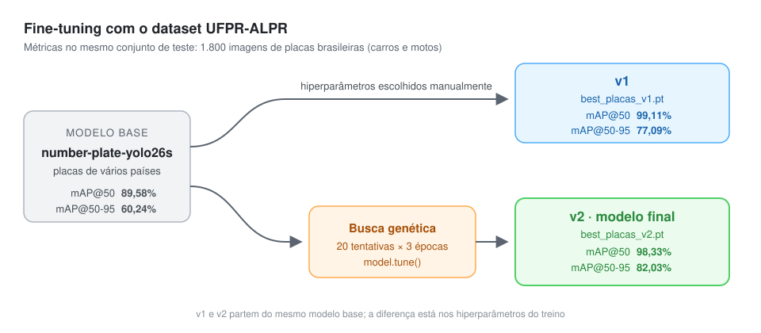

# Detecção de Placas Veiculares Brasileiras com YOLO26s

[](https://huggingface.co/RodrigoRRC/license-plate-br-yolo26s)
[](https://www.kaggle.com/code/rodrigorrc/03-avaliacao-base-v1-v2)
[](#licença)

Modelo de visão computacional que localiza placas de carros e motos em imagens de trânsito brasileiro.

O ponto de partida foi o `number-plate-yolo26s`, um detector treinado com placas de vários países. Ele foi ajustado ao padrão brasileiro com o dataset **UFPR-ALPR**, em duas etapas:

1. **v1**: fine-tuning com hiperparâmetros escolhidos manualmente
2. **v2**: fine-tuning com hiperparâmetros encontrados por busca genética (`model.tune()` do Ultralytics)

O modelo final (v2) atinge **mAP@50-95 de 82,03%** no conjunto de teste, contra 60,24% do modelo base, e está disponível para uso no HuggingFace.



---

## Resultado

Os três modelos foram avaliados no **mesmo conjunto de teste** do UFPR-ALPR (1.800 imagens que não foram usadas no treino), com as mesmas configurações.

| Métrica | Modelo base | v1 | v2 |
|---|---|---|---|
| mAP@50 | 89,58% | **99,11%** | 98,33% |
| mAP@50-95 | 60,24% | 77,09% | **82,03%** |
| Precisão | 86,32% | 96,99% | **97,69%** |
| Recall | 89,77% | 96,17% | **98,78%** |

**O que cada métrica mede:**
- **Precisão:** das placas que o modelo apontou, quantas eram placas de verdade
- **Recall:** das placas que existiam nas imagens, quantas o modelo encontrou
- **mAP@50:** taxa de acerto quando basta a caixa prevista se sobrepor pelo menos 50% à caixa real (critério tolerante)
- **mAP@50-95:** média da taxa de acerto em critérios cada vez mais exigentes, de 50% até 95% de sobreposição. Mede o quão justa a caixa fica em volta da placa

**Leitura dos resultados:** o fine-tuning melhorou todas as métricas em relação ao modelo base. O v1 e o v2 encontram praticamente todas as placas (mAP@50 acima de 98%). O ganho do v2 está no **mAP@50-95 (+4,9 pontos)**, ou seja, as caixas ficam mais bem ajustadas à placa.

📓 Avaliação completa, com as saídas gravadas: [`notebooks/03_avaliacao_base_v1_v2.ipynb`](notebooks/03_avaliacao_base_v1_v2.ipynb) · [Kaggle](https://www.kaggle.com/code/rodrigorrc/03-avaliacao-base-v1-v2)

---

## Como usar o modelo

**1. Instalar as bibliotecas**

```bash
pip install ultralytics huggingface_hub
```

**2. Baixar o modelo do HuggingFace**

```python
from huggingface_hub import hf_hub_download

caminho_modelo = hf_hub_download(
    repo_id="RodrigoRRC/license-plate-br-yolo26s",
    filename="best_placas_v2.pt",   # ou "best_placas_v1.pt"
)
```

**3. Detectar placas numa imagem**

```python
from ultralytics import YOLO

modelo = YOLO(caminho_modelo)
resultado = modelo.predict(source="sua_imagem.jpg", conf=0.5)[0]

resultado.save("resultado.jpg")   # salva a imagem com as placas marcadas

for caixa in resultado.boxes:
    x1, y1, x2, y2 = caixa.xyxy[0].tolist()
    print(f"Placa em ({x1:.0f}, {y1:.0f}) até ({x2:.0f}, {y2:.0f}) · confiança {caixa.conf[0]:.0%}")
```

- `conf=0.5` → só mostra detecções com pelo menos 50% de confiança. Diminua para achar mais placas, aumente para ter menos alarmes falsos
- O modelo **localiza** a placa (desenha a caixa). Ele **não lê** os caracteres
